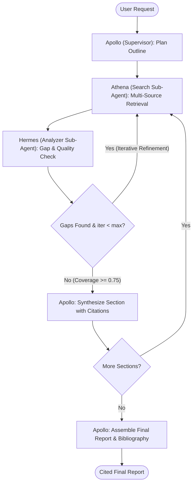

# 🚀 Apollo: Deep Research Meta-Agent

[](https://github.com/your-org/apollo/actions)
[](https://www.python.org/downloads/)
[](https://github.com/langchain-ai/langgraph)
[](https://fastapi.tiangolo.com)
[](https://streamlit.io)

**Apollo** is a production-grade multi-agent research orchestrator designed to solve complex, multi-faceted research tasks. It coordinates specialized autonomous sub-agents within a deterministic **LangGraph finite state machine** to gather, verify, analyze, and synthesize structured, citation-backed research reports.

---

## 🏛️ Architecture & Agent Topology

The system implements a **Supervisor State Machine** pattern:



### Agent Roles

1. **Apollo (Meta-Agent / Supervisor)**
   - **Query Decomposition**: Deconstructs user query into a structured multi-section itinerary (`SectionOutline`).
   - **Section Synthesis (Stage 1)**: Generates detailed section-specific content with strict inline source attribution (`[1]`, `[2]`).
   - **Report Assembly (Stage 2)**: Synthesizes executive summary, consolidates cross-references, and compiles a unified, deduplicated bibliography.

2. **Athena (Search Engine Sub-Agent)**
   - **Multi-Source Retrieval**: Queries live web (Tavily), scholarly literature (Semantic Scholar), and financial filings (SEC EDGAR).
   - **Data Normalization**: Cleans, deduplicates, and calculates initial relevance scores for all evidence pieces.

3. **Hermes (Analyzer Sub-Agent)**
   - **Reflexion Loop**: Audits retrieved evidence against outline key questions.
   - **Gap Detection**: Computes a quantitative coverage score (0.0 to 1.0). If gaps exist, generates targeted follow-up queries for Athena.

---

## 📁 Repository Structure

```
D:\apollo\
├── src/
│   ├── main.py                    # FastAPI application entrypoint
│   ├── config.py                  # Pydantic-settings configuration
│   ├── models/                    # Pydantic v2 schemas & LangGraph state
│   │   ├── state.py               # ResearchState, Evidence, SectionOutline, GapReport, Citation
│   │   ├── requests.py            # API request models
│   │   └── responses.py           # API response models & enums
│   ├── agents/                    # LangGraph node implementations
│   │   ├── apollo.py              # Supervisor planning, synthesis, assembly
│   │   ├── athena.py              # Search agent with ReAct tool execution
│   │   ├── hermes.py              # Analyzer agent for gap detection
│   │   └── graph.py               # StateGraph compilation & conditional edges
│   ├── tools/                     # Strictly typed search tool integrations
│   │   ├── base.py                # Exponential backoff, ToolError, SearchResult
│   │   ├── web_search.py          # Tavily Search API
│   │   ├── academic_search.py     # Semantic Scholar API
│   │   └── financial_search.py    # SEC EDGAR full-text search
│   ├── prompts/                   # Structured agent prompts (Chain-of-Thought / Reflexion)
│   ├── services/                  # Business logic services
│   │   ├── citation_manager.py    # Citation registry, inline renumbering, bibliography
│   │   └── report_generator.py    # Multi-stage synthesis & markdown export
│   ├── api/                       # REST endpoints & WebSocket streaming
│   │   └── routes.py              # FastAPI router
│   └── utils/
│       ├── logging.py             # Structlog configuration (JSON/console)
│       └── callbacks.py           # Token tracking & cost estimation
├── frontend/
│   └── app.py                     # Streamlit real-time interactive UI
├── tests/                         # Pytest test suite (unit & integration tests)
├── Dockerfile                     # Multi-stage lean container build
├── docker-compose.yml             # Single-command API + Frontend deployment
├── pyproject.toml                 # PEP 621 dependencies & tooling configs
└── .env.example                   # Environment configuration template
```

---

## ⚡ Quick Start

### 1. Environment Setup

Copy `.env.example` to `.env` and fill in your API credentials:

```bash
cp .env.example .env
```

Configure your keys:
```env
GEMINI_API_KEY=your_gemini_api_key
TAVILY_API_KEY=your_tavily_api_key
OPENAI_API_KEY=your_openai_api_key_optional
```

### 2. Run with Docker Compose (Recommended)

```bash
docker-compose up --build
```

- **Backend API**: `http://localhost:8000`
- **Interactive Swagger Docs**: `http://localhost:8000/docs`
- **Streamlit Web UI**: `http://localhost:8501`

### 3. Local Development

```bash
# Install dependencies
pip install -e ".[dev]"

# Start backend server
python -m uvicorn src.main:app --host 0.0.0.0 --port 8000 --reload

# Start Streamlit UI in a separate terminal
streamlit run frontend/app.py --server.port 8501
```

---

## 🧪 Testing

Execute the comprehensive test suite:

```bash
pytest -v
```

All 33 test cases cover model validation, LangGraph state machine routing, citation management, report generation, and mocked agent executions.

---

## 🛡️ Guardrails & Reliability Engineering

- **Loop Bounding**: Hard capped to `max_iterations` per section (default 5).
- **Stagnation Detection**: Terminates searching early if coverage score delta < 0.05 across consecutive cycles.
- **Token Budget Protection**: Hard stop triggered if LLM token consumption reaches the configured threshold.
- **Provider Fallback**: Seamless switch from Gemini Flash to OpenAI GPT-4o upon transient API rate limits or outages.
- **Type Safety**: Strictly enforced Pydantic v2 schemas across all tool inputs, agent outputs, and API payloads.
